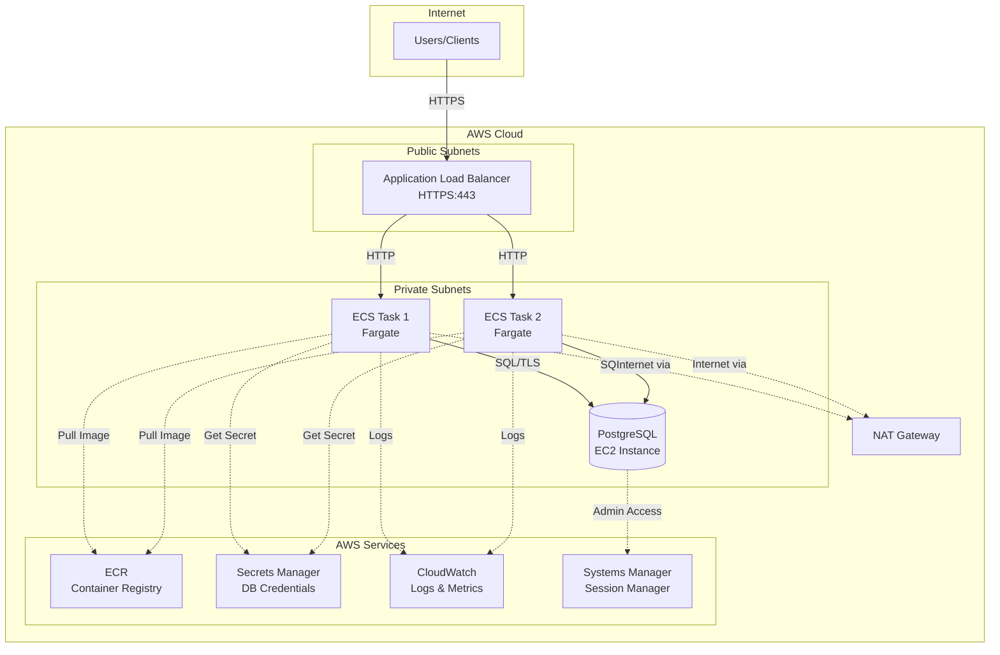
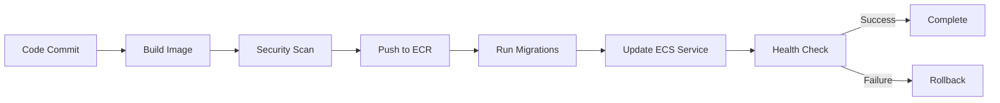

# Architecture Overview

## System Architecture

## Component Breakdown

### Application Tier
- **FastAPI Application**: Python 3.11 REST API with synchronous request handlers
- **Uvicorn ASGI Server**: Production-grade application server
- **Container Runtime**: Docker on AWS Fargate (serverless containers)
- **Deployment**: ECS Service with rolling updates and health checks

### Data Tier
- **PostgreSQL 16**: Relational database for claim persistence
- **Deployment**: EC2 instance (simulating legacy on-premises database)
- **Access**: Private subnet, security group restricted to application tier
- **Administration**: AWS Systems Manager Session Manager (no SSH)

### Network Tier
- **VPC**: Isolated network with public and private subnets across 2 AZs
- **Load Balancer**: Internet-facing ALB with HTTPS termination
- **NAT Gateway**: Single NAT for private subnet internet access (ECR, Secrets Manager, etc.)
- **DNS**: Route 53 or external DNS pointing to ALB

### Security
- **Authentication**: JWT/OIDC tokens validated against trusted issuer
- **Secrets**: Database credentials stored in AWS Secrets Manager
- **Network**: Security groups enforce least-privilege access
- **TLS**: HTTPS required for ALB, TLS for database connections
- **IAM**: Separate task and execution roles with scoped permissions

### Observability
- **Logging**: Structured JSON logs to CloudWatch Logs
- **Metrics**: CloudWatch Container Insights and custom metrics
- **Alarms**: Target health, error rate, resource utilization
- **Dashboard**: Real-time view of application health and performance
- **Correlation**: Request correlation IDs through the stack

## Data Flow

### Create Claim Request
1. Client sends HTTPS POST to ALB with JWT token
2. ALB terminates TLS and forwards to healthy ECS task
3. Application validates JWT against OIDC provider
4. Application validates request body with Pydantic
5. Repository inserts claim into PostgreSQL with generated UUID
6. Transaction commits and claim returned to client
7. Structured log entry with correlation ID written to CloudWatch

### Health Check Flow
- **Liveness**: Process health, no external dependencies
- **Readiness**: Database connectivity check with 5-second timeout
- **ALB**: Checks readiness endpoint every 30 seconds
- **ECS**: Container-level health check for task restart

## Deployment Pipeline

## Scaling Strategy

- **Horizontal**: ECS tasks scale based on CPU/memory metrics
- **Vertical**: Task CPU/memory configurable per environment
- **Database**: Single instance (scaled differently in production)
- **Connection Pooling**: SQLAlchemy manages database connections

## High Availability

**Implemented:**
- Multiple AZs for compute (ECS tasks in 2 AZs)
- ALB health checks and automatic task replacement
- Deployment circuit breaker prevents bad deploys
- Graceful shutdown coordinated with ALB deregistration

**Not Implemented (Training Limitation):**
- Single NAT Gateway (cost optimization for training)
- Single database instance (migration exercise in Week 2)
- No cross-region redundancy
- No automated disaster recovery

## Cost Optimization

- Fargate Spot not used (prioritize availability for training)
- Single NAT Gateway instead of per-AZ
- Minimal task sizing (512 CPU / 1024 MB memory)
- CloudWatch log retention limited to 7 days
- ECR lifecycle policy removes old images

## Security Boundaries

- **Perimeter**: ALB with restricted CIDR ingress
- **Application**: JWT authentication on business endpoints
- **Network**: Security groups enforce least privilege
- **Data**: Secrets Manager, encrypted storage, TLS in transit
- **Audit**: CloudWatch Logs capture all requests with correlation IDs

## Technology Decisions

See [service-decisions.md](service-decisions.md) for detailed rationale on:
- Why ECS Fargate vs EC2, Lambda, or EKS
- Why single RDS was avoided (Week 2 migration focus)
- Why NAT Gateway vs VPC Endpoints
- Authentication approach and library choices
